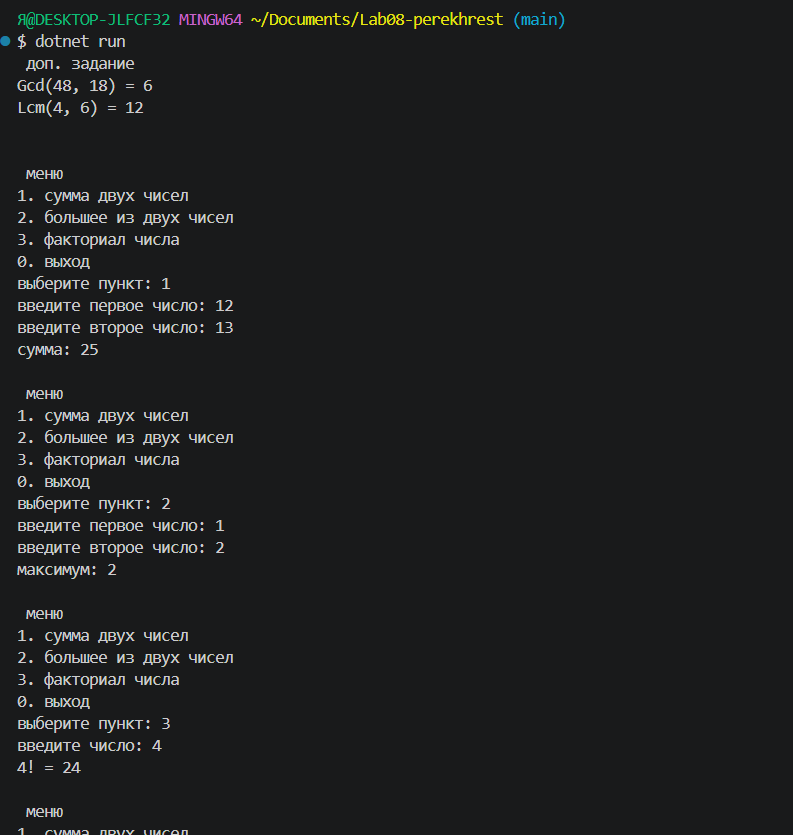
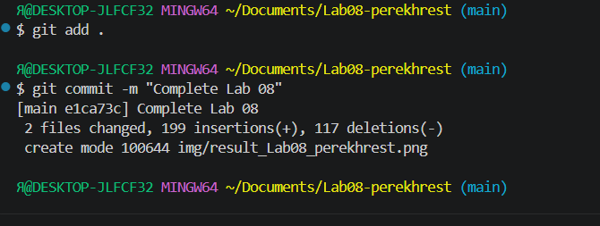

# Практическая работа №8

**ФИО:** Перехрест Александра
**Группа:** исп-242
**Дата:** 17.10.2026

## Что изучено

- научилась создавать методы типа `void`, которые выполняют действие и не возвращают результат (например, `PrintHeader`), и поняла, чем они отличаются от методов с `return`.
- разобралась, как передавать данные в метод через параметры и возвращать результат с помощью `return` (на примере `Max`, `IsEven`, `Factorial`).
- поняла, как выносить повторяющийся код в методы (например, `ToFahrenheit`) и как передавать массивы в методы (`Average`, `CountGreater`).

## Скриншоты

 
